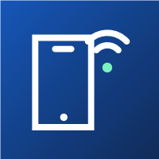

<p align="center">
  
</p>

# Android via Wi-Fi para Visual Studio

Descubra, pareie e conecte dispositivos Android pela rede sem fio a partir de uma janela do Visual Studio.

[](https://github.com/afernandes/DiscoveryDeviceAndroid/actions/workflows/ci.yml)
[](https://github.com/afernandes/DiscoveryDeviceAndroid/actions/workflows/codeql.yml)
[](LICENSE.txt)
[](CHANGELOG.md)

**[Baixar uma release](https://github.com/afernandes/DiscoveryDeviceAndroid/releases)** · [Instalar](docs/INSTALACAO.md) · [Documentação](docs/README.md) · [Relatar problema](https://github.com/afernandes/DiscoveryDeviceAndroid/issues/new/choose)

## O que a extensão oferece

- Descoberta automática por mDNS e busca por modelo, instância ou endereço.
- Modelo, API e versão ADB Wi-Fi quando o dispositivo fornece esses dados.
- Pareamento com QR code temporário ou código de seis dígitos.
- Conexão e desconexão manuais por IP e porta.
- Lista de dispositivos e estados reportados pelo ADB.
- Interface em português do Brasil e uso do Android SDK já instalado.

Não é necessário abrir ou instalar o Android Studio para usar a extensão.

## Instalação

1. Abra [Releases](https://github.com/afernandes/DiscoveryDeviceAndroid/releases) e baixe o `.vsix` ou o ZIP com sufixo `devs`.
2. Se baixou o ZIP, extraia-o e abra o `.vsix` com dois cliques.
3. Conclua o instalador para o Visual Studio compatível.
4. Abra **Ferramentas → Android via Wi-Fi**.

O arquivo `SHA256SUMS.txt` da release permite conferir a integridade dos downloads. Os pacotes atuais não são assinados com certificado do autor. Instruções completas e diagnóstico estão no [guia de instalação](docs/INSTALACAO.md).

## Requisitos

| Componente | Requisito declarado |
|---|---|
| Computador | Windows x64 |
| IDE | Visual Studio 2022 17.14 ou Visual Studio 2026 |
| SDK Android | Platform-Tools instalado; caminho do ADB configurável |
| Dispositivo | Android 11 ou superior com Depuração sem fio habilitada |
| Rede | Comunicação permitida entre computador e aparelho |

O pacote não declara ARM64. A compatibilidade declarada ainda não foi homologada em todas as versões do IDE e do Android.

## Primeiro pareamento

1. Conecte os dois dispositivos à mesma rede e ative **Opções do desenvolvedor → Depuração sem fio** no Android.
2. Para QR, clique em **Gerar novo QR code** na extensão e escolha **Parear dispositivo com QR code** no aparelho.
3. Para código, abra **Parear dispositivo com código de pareamento** no Android, selecione o serviço correspondente ou informe o endereço e o código temporário.
4. Aguarde o estado `device` na lista do ADB.
5. Se não conectar automaticamente, use a aba **Conexão manual** com o endereço da tela principal de Depuração sem fio.

As portas de pareamento e de conexão são diferentes. Redes que bloqueiam multicast mDNS podem exigir entrada manual. Use o mesmo SDK/ADB configurado no Visual Studio para compartilhar os dispositivos com o seletor de depuração.

## Estado da prévia

O carregamento da janela e a descoberta de um SM-X820 foram observados. Os testes automatizados cobrem parsing, endereços, subprocessos, timeout, cancelamento e renderização/decodificação do QR no WPF.

**Ainda precisam de validação:** pareamento físico completo, confirmação do primeiro QR no host remoto, instalação limpa em outras máquinas e depuração real de um aplicativo. Consulte a [matriz de integração](docs/VALIDACAO-FISICA.md) e o [histórico de validação](docs/validacao.md).

## Desenvolver e contribuir

Requer Windows, PowerShell 7.2+, SDK .NET 10 estável e runtime .NET 8 Desktop. Os testes não precisam de aparelho conectado nem de ADB instalado.

```powershell
git clone https://github.com/afernandes/DiscoveryDeviceAndroid.git
cd DiscoveryDeviceAndroid
pwsh ./scripts/Verificar.ps1
```

A verificação restaura dependências com lock files, audita transitivas, confere formatação, compila e executa os testes. Leia [CONTRIBUTING.md](CONTRIBUTING.md) antes de abrir um PR.

Para gerar uma distribuição local:

```powershell
pwsh ./scripts/Empacotar.ps1 -DiretorioSaida ./artifacts/minha-distribuicao
```

Os artefatos são gerados fora do código versionado e o script preserva diretórios já existentes. O CI entrega os mesmos tipos de pacote como artefatos; a [publicação de releases](docs/MANUTENCAO.md) é iniciada manualmente e não envia arquivos ao Marketplace.

## Organização

| Diretório | Conteúdo |
|---|---|
| `DiscoveryDeviceAndroid` | Extensão, pareamento e Remote UI |
| `DiscoveryDeviceAndroid.Core` | Descoberta, conexão e infraestrutura ADB |
| `DiscoveryDeviceAndroid.Tests` | Contratos e execução de processos |
| `DiscoveryDeviceAndroid.UiTests` | Binding e renderização WPF do QR |
| `scripts` | Validação, empacotamento, release e configuração do repositório |
| `.github` | Workflows, templates e políticas versionadas |
| `docs` | Guias, arquitetura, validação e evidências |
| `marketplace` | Materiais da página da loja |

## Licença e contato

Distribuído sob a [MIT](LICENSE.txt). Os avisos e licenças das dependências são incluídos no VSIX e nos ZIPs. A extensão não incorpora o ADB nem binários do Android Studio.

Para dúvidas e sugestões, use [Issues](https://github.com/afernandes/DiscoveryDeviceAndroid/issues/new/choose). Para vulnerabilidades, siga o [canal privado](SECURITY.md). Não há vínculo oficial com Google ou Microsoft; as marcas pertencem aos respectivos titulares.
